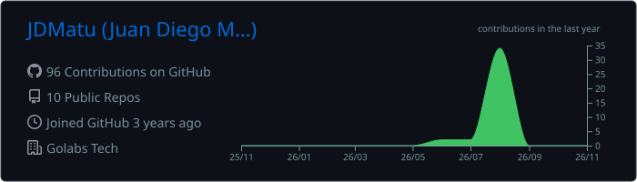
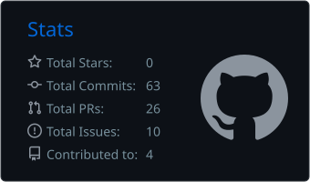
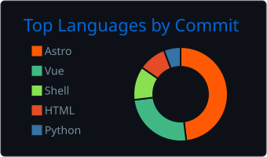

<picture>
  <source media="(prefers-color-scheme: dark)" srcset="./assets/header-dark.svg">
  <source media="(prefers-color-scheme: light)" srcset="./assets/header-light.svg">
  
</picture>

  <a href="https://portfolio-three-sandy-55.vercel.app/">Portfolio</a> &nbsp;·&nbsp;
  <a href="https://www.linkedin.com/in/jdmatu/">LinkedIn</a> &nbsp;·&nbsp;
  <a href="mailto:juandiegomatute11@gmail.com">Email</a> &nbsp;·&nbsp;
  <a href="https://portfolio-three-sandy-55.vercel.app/assets/Juan-Diego-Matute-CV.pdf">CV</a>

I'm a software developer from Costa Rica building production software where **backend engineering, data and applied AI** meet. Most of what I build starts as a diagram (tables, relations, flows) before it becomes code, and I bring AI in where it improves a process, not because it's trending.

### `> currently`

- **Building** enterprise apps, internal tools and AI features at **GoLabs**
- **Exploring** agents, MCP, context engineering and LLM evals
- **Studying** Software Engineering at **Universidad Técnica Nacional**

### `> selected work`

<table>
  <tr>
    <td width="200" valign="top"><b><a href="https://www.smartcoopcr.com/">SmartCoop</a></b> lead developer · 2023–2026</td>
    <td>Platform for student cooperatives: members, savings, voting, accounting and reports. Designed the data model and built it from scratch to real users in production. <code>Flask</code> <code>MySQL</code> <code>Dashboards</code> 1st place · Expo Técnica Nacional 2024 &nbsp;·&nbsp; 1st place · Coop Impact, CENECOOP R.L.</td>
  </tr>
  <tr>
    <td width="200" valign="top"><b><a href="https://portfolio-three-sandy-55.vercel.app/projects.html">Hiring Intelligence</a></b> applied AI · GoLabs</td>
    <td>Normalizes job postings, generates embeddings and matches candidates through semantic vector search. <code>Django</code> <code>pgvector</code> <code>OpenAI API</code></td>
  </tr>
  <tr>
    <td width="200" valign="top"><b><a href="https://portfolio-three-sandy-55.vercel.app/projects.html">Gacela</a></b> enterprise product · GoLabs</td>
    <td>New modules, business flows and UI work on a live product the team uses every day. <code>Vue</code> <code>Laravel</code> <code>GraphQL</code></td>
  </tr>
</table>

### `> engineering toolkit`

<table>
  <tr><th align="left">layer</th><th align="left">stack</th><th align="left">shipped in</th></tr>
  <tr>
    <td><b>Backend</b></td>
    <td><picture><source media="(prefers-color-scheme: dark)" srcset="https://skillicons.dev/icons?i=py,django,flask,laravel,ts&theme=dark"><source media="(prefers-color-scheme: light)" srcset="https://skillicons.dev/icons?i=py,django,flask,laravel,ts&theme=light"></picture></td>
    <td>SmartCoop · Gacela</td>
  </tr>
  <tr>
    <td><b>Data</b></td>
    <td><picture><source media="(prefers-color-scheme: dark)" srcset="https://skillicons.dev/icons?i=postgres,mysql,graphql&theme=dark"><source media="(prefers-color-scheme: light)" srcset="https://skillicons.dev/icons?i=postgres,mysql,graphql&theme=light"></picture> pgvector · SQL modeling</td>
    <td>Hiring Intelligence · SmartCoop</td>
  </tr>
  <tr>
    <td><b>AI</b></td>
    <td><picture><source media="(prefers-color-scheme: dark)" srcset="./assets/ai-dark.svg"><source media="(prefers-color-scheme: light)" srcset="./assets/ai-light.svg"></picture> RAG · embeddings · agents · evals</td>
    <td>Hiring Intelligence · agents</td>
  </tr>
  <tr>
    <td><b>Interfaces</b></td>
    <td><picture><source media="(prefers-color-scheme: dark)" srcset="https://skillicons.dev/icons?i=vue,react,tailwind&theme=dark"><source media="(prefers-color-scheme: light)" srcset="https://skillicons.dev/icons?i=vue,react,tailwind&theme=light"></picture></td>
    <td>Gacela</td>
  </tr>
  <tr>
    <td><b>Delivery</b></td>
    <td><picture><source media="(prefers-color-scheme: dark)" srcset="https://skillicons.dev/icons?i=aws,docker,linux,git,vercel&theme=dark"><source media="(prefers-color-scheme: light)" srcset="https://skillicons.dev/icons?i=aws,docker,linux,git,vercel&theme=light"></picture></td>
    <td>GoLabs production</td>
  </tr>
</table>

### `> activity`

  <picture><source media="(prefers-color-scheme: dark)" srcset="./profile-summary-card-output/github_dark/0-profile-details.svg"><source media="(prefers-color-scheme: light)" srcset="./profile-summary-card-output/github/0-profile-details.svg"></picture>

  <picture><source media="(prefers-color-scheme: dark)" srcset="./profile-summary-card-output/github_dark/3-stats.svg"><source media="(prefers-color-scheme: light)" srcset="./profile-summary-card-output/github/3-stats.svg"></picture>
  <picture><source media="(prefers-color-scheme: dark)" srcset="./profile-summary-card-output/github_dark/2-most-commit-language.svg"><source media="(prefers-color-scheme: light)" srcset="./profile-summary-card-output/github/2-most-commit-language.svg"></picture>

